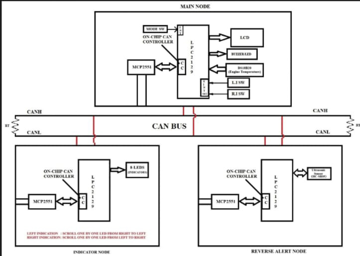
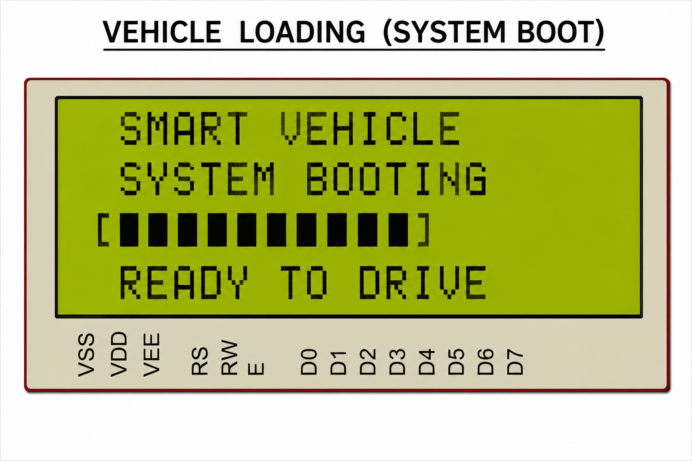
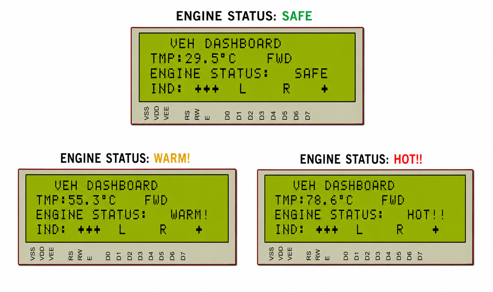
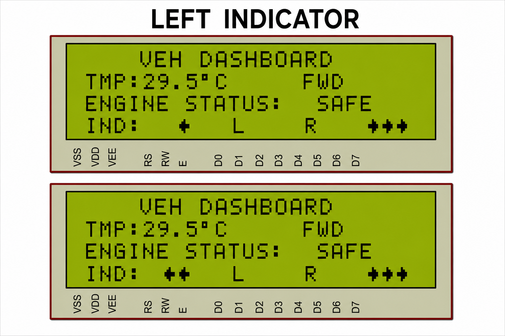
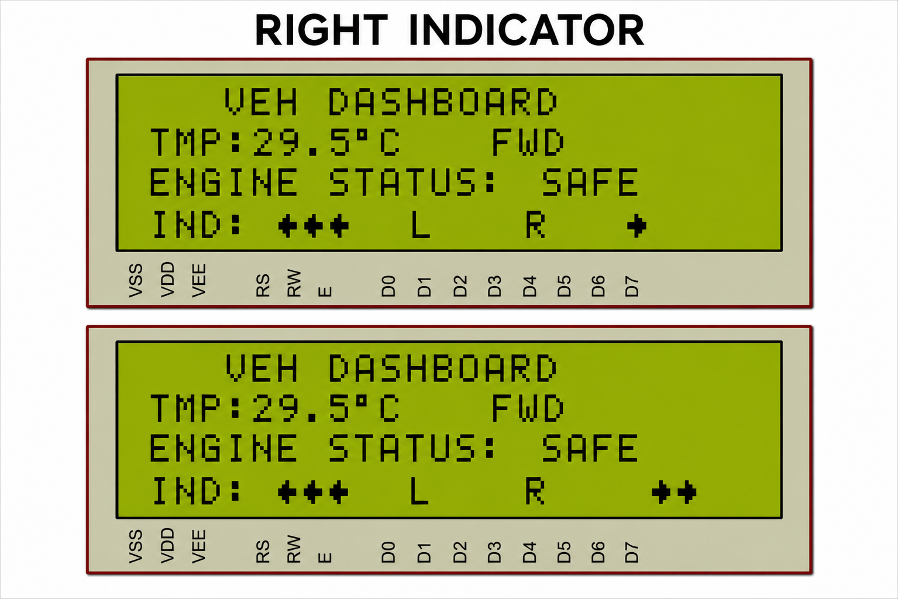
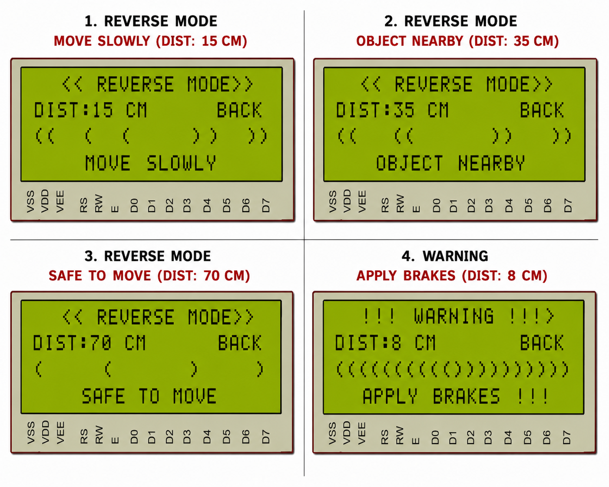

# 🚗 CAN-Based Vehicle Monitoring and Reverse Safety System

## 📖 Overview

The **CAN-Based Vehicle Monitoring and Reverse Safety System** is an automotive embedded project developed using the **LPC2129 ARM7 Microcontroller** and the **Controller Area Network (CAN) Protocol**.

This project implements a distributed automotive monitoring architecture in which multiple microcontroller nodes communicate over a common CAN bus. The system integrates vehicle indicator control, temperature monitoring, and ultrasonic-based reverse obstacle detection to demonstrate essential vehicle monitoring and safety functions.

### Key Features

- 🌡️ Engine Temperature Monitoring
- 🚦 Left and Right Indicator Control
- 📡 Multi-Node CAN Bus Communication
- 🚘 Reverse Obstacle Distance Measurement
- 🖥️ LCD-Based Vehicle Status Display
- 🚨 Distance-Based Safety Warnings
- 🔄 Distributed Automotive Embedded Architecture

---

## 🎯 Project Objective

The primary objective is to design and implement a multi-node automotive monitoring system using the CAN communication protocol. Each node performs a dedicated function, such as monitoring temperature, controlling indicators, or detecting obstacles behind the vehicle.

The system exchanges relevant data between nodes and presents vehicle status and reverse safety information through an LCD interface, demonstrating the practical application of embedded systems in automotive electronics.

---

## 🏗️ System Architecture

### Main Node

The Main Node serves as the primary monitoring and coordination unit of the system.

**Functions**

- Reads and processes engine temperature sensor data.
- Displays vehicle status and monitoring information on the LCD.
- Manages indicator control commands.
- Receives relevant information from other CAN nodes.
- Presents reverse obstacle warnings based on received data.

---

### Indicator Node

The Indicator Node handles left and right indicator operations according to control commands received through the CAN network.

**Functions**

- Left indicator activation and control.
- Right indicator activation and control.
- Sequential LED indicator patterns.
- Processing of CAN communication messages.
- Independent execution of indicator operations.

---

### Reverse Safety Node

The Reverse Safety Node monitors the area behind the vehicle using an ultrasonic distance sensor and communicates obstacle information through the CAN bus.

**Functions**

- Measures the distance between the vehicle and nearby obstacles.
- Identifies obstacles within predefined warning ranges.
- Transmits distance and safety status information through CAN.
- Supports reverse parking assistance.
- Enables the Main Node to display reverse safety alerts.

---

## 🖼️ System Block Diagram

<p align="center">
  
</p>

---

## 🚀 Vehicle Startup and Initialization

During startup, the microcontroller initializes the required peripherals and prepares the monitoring system for operation.

<p align="center">
  
</p>

**Startup Functions**

- Microcontroller peripheral initialization.
- LCD configuration and dashboard preparation.
- Initialization of CAN communication.
- Preparation of sensor and indicator interfaces.
- Display of the initial vehicle status.

---

## 🌡️ Engine Temperature Monitoring

The system monitors engine temperature using the configured temperature sensor interface. The measured value can be processed and displayed on the vehicle dashboard to indicate the engine's operating condition.

<p align="center">
  
</p>

### Temperature Status Classification

| Temperature Range | Indicated Status |
| ----------------- | ---------------- |
| Below 40°C        | 🟢 SAFE          |
| 40°C–69°C         | 🟡 WARM          |
| 70°C and above    | 🔴 HOT           |

The dashboard updates the engine status according to the measured temperature and the configured threshold values.


---

## ⬅️ Left Indicator Control

The left indicator function demonstrates how indicator commands can be processed within a distributed automotive control system.

<p align="center">
  
</p>

**Highlights**

- Left-side LED indicator activation.
- Sequential indicator animation.
- CAN-based command communication.
- Coordinated operation between system nodes.
- Visual representation of vehicle turning signals.

---

## ➡️ Right Indicator Control

The right indicator function demonstrates the corresponding control operation for the right-side vehicle indicators.

<p align="center">
  
</p>

**Highlights**

- Right-side LED indicator activation.
- Sequential LED control patterns.
- Communication through the CAN network.
- Independent indicator operation.
- Integration with the overall vehicle monitoring system.

---

## 🚨 Reverse Obstacle Detection and Safety Assistance

The reverse safety function uses an HC-SR05 ultrasonic sensor to measure the distance between the vehicle and obstacles behind it.

<p align="center">
  
</p>

###  Warning Levels

| Obstacle Distance | Safety Indication    |
| ----------------- | -------------------- |
| Above 50 cm       | 🟢 Safe Distance     |
| 20–50 cm          | 🟡 Object Nearby     |
| 10–20 cm          | 🟠 Move Carefully    |
| 10 cm or less     | 🔴 Immediate Warning |

The Reverse Safety Node processes the measured distance and transmits the relevant information through the CAN bus. The Main Node can then display the received distance or warning status on the LCD.

---

## ⚙️ Hardware Requirements

| Component    | Description           |
| ------------ | --------------------- |
| LPC2129      | ARM7 Microcontroller  |
| MCP2551      | CAN Transceiver       |
| DS18B20      | Temperature Sensor    |
| HC-SR05      | Ultrasonic Sensor     |
| 20x4 LCD     | Display Unit          |
| LEDs         | Indicator Simulation  |
| Buzzer       | Warning Alert         |
| Push Buttons | User Inputs           |
| USB-UART     | Programming Interface |


---

## 💻 Software Requirements

- Embedded C Programming
- Keil µVision IDE
- Flash Magic
- Proteus Design Suite
- LPC2129 Device Support and Header Files

---

## 📂 Repository Structure

```text
CAN-Based-Vehicle-Monitoring-and-Reverse-Safety-System
│
├── Main_Node/
│   ├── main.c
│   └── Supporting source and header files
│
├── Indicator_Node/
│   ├── main.c
│   └── Supporting source and header files
│
├── Reverse_Safety_Node/
│   ├── main.c
│   └── Supporting source and header files
│
├── Images/
│   ├── BLOCK_DIAGRAM.png
│   ├── VEHICLE_LOADING.png
│   ├── ENGINE_STATUS.png
│   ├── LEFT_INDICATOR.png
│   ├── RIGHT_INDICATOR.png
│   └── REVERSE_MODE.png
│
└── README.md
```

---

## ✅ Advantages

- Demonstrates multi-node automotive communication.
- Enables centralized monitoring of vehicle information.
- Supports reverse obstacle detection and distance-based warnings.
- Separates indicator, monitoring, and reverse safety functions.
- Demonstrates CAN message exchange between embedded controllers.
- Improves modularity and maintainability of the prototype.
- Provides practical experience with automotive embedded development.
- Can be extended with additional sensors and monitoring functions.

---

## 📚 Learning Outcomes

- Embedded C programming for ARM7 microcontrollers.
- LPC2129 peripheral configuration and GPIO control.
- CAN protocol configuration and message transmission.
- CAN message reception and inter-node communication.
- Ultrasonic sensor interfacing and distance calculation.
- LCD interfacing and dashboard display development.
- Embedded debugging using Keil µVision.
- Hardware testing and circuit simulation using Proteus.
- Understanding distributed automotive electronic control systems.

---

## 🔮 Future Enhancements

- Add CAN communication fault detection and error reporting.
- Introduce configurable obstacle warning thresholds.
- Add audible alerts for different obstacle distances.
- Integrate additional vehicle sensors.
- Implement diagnostic messages and system status monitoring.
- Extend the prototype with fault-handling and communication recovery features.

---

## 👨‍💻 Author

### Dandu Deepak Varma

**Embedded Systems | Automotive Electronics | Firmware Development**

Interested in embedded C programming, ARM microcontrollers, CAN communication, automotive electronics, and real-time embedded system development.

**Project:** CAN-Based Vehicle Monitoring and Reverse Safety System

**Technologies:** LPC2129 ARM7, Embedded C, CAN Protocol, Ultrasonic Sensor, LCD Interfacing, Keil µVision, and Proteus.

